# MORI AI Growth OS

> **MORI 森屿 AI 美妆增长中台** — AI-Powered Growth Intelligence for Modern Brands
> 让 AI 帮品牌完成从用户洞察到增长优化的完整闭环。

> ⚠️ **Demo 说明**：`MORI 森屿` 是**虚拟品牌**，`AURA LAB / NUVIA / LUMIÉ` 是**虚拟竞品**，项目内所有业务数据均为
> **Demo / 模拟业务数据**。本项目**不冒充任何真实公司**，也**不声称任何真实商业成绩**（没有“销售额提升 300%”这类表述）。
> 项目重点验证的是：**AI 在营销分析与增长决策中的应用工作流**。

**一句话介绍**：AI 驱动的营销增长决策工作台 —— 把市场洞察、用户分析、内容策划、广告投放、数据分析、
AI 诊断与实验优化串成完整增长闭环。

**产品闭环**：

```text
Market → Audience → Content → Creative → Campaign → Analytics → AI Insight → Experiment → Optimization → Report
```

**快速导航**：为什么做 MORI · Demo 数据说明 · 我的工作与 Codex 的分工 · 核心功能模块 · AI Agent 架构 ·
Campaign Analytics · Experiment Lab · AI 可靠性设计 · 作品集 Case Study · 本地运行 · 测试 · Deployment
（GitHub 右上角的 Outline 可直接跳转）

---

## Overview

MORI AI Growth OS 是一个可以真实运行、可以完整演示的 **AI 增长中台**，把品牌市场/增长团队每天要做的事情连接成一条链路：

```
市场调研 → 用户洞察 → 内容策划 → 素材生产 → 广告投放 → 数据分析 → AI 诊断 → 优化建议 → 下一轮实验
```

它不是“输入一句话 → AI 给你一篇文章”的 Demo，而是：

> **品牌信息 + 用户 + 产品 + 投放数据 → AI 自动分析（结构化输出）→ 商业决策建议 → 实验 → 复盘报告**

技术上是 **Next.js 15 + TypeScript + Tailwind + Prisma(SQLite) + Recharts**，AI 侧使用
**OpenAI-compatible Structured Outputs（JSON Schema）**，并由 6 个专职 Agent + 1 个报告 Agent 分工完成。

**无需任何 API Key 也能完整演示**（Demo Mode 使用本地结构化分析引擎，所有数字仍来自数据库实时计算）。

---

## 为什么做 MORI（Why I Built MORI）

我不满足于"做一个能聊天的 AI 页面"，也不认为自己应该去拼算法。我的判断是：
**AI 在营销增长里的真正价值，取决于业务问题被拆解得有多清楚、数据口径有多可靠。**

所以 MORI 要验证的是一个假设：

> 如果把品牌、产品、人群、竞品、投放、内容、实验这些上下文结构化地交给 AI，
> 它能不能产出**可执行、可复核、可继续迭代**的增长决策？

现实中的增长工作每天都要跨过这几步，而最耗时、最容易断链的正是"从洞察到行动"这一步：

```text
市场洞察 → 用户研究 → 内容策划 → 素材制作 → 广告投放 → 数据分析 → 增长决策
```

常见问题：信息分散（口径不统一）、数据与内容脱节（内容不知道哪条素材在亏钱）、分析依赖人工、
洞察难以转化为行动、实验与复盘没有形成闭环。

我的背景（税收学 / 商科）反而决定了我的切入点：我更关心**问题定义、指标口径、决策质量与实验设计**，
而不是模型参数。MORI 就是把这些判断做成一个可以真实运行的工作台。

> 边界说明：MORI 是**个人作品集项目**，不是生产系统；所有业务数据均为 Demo / 模拟数据，
> 用于验证"AI 如何参与业务决策"的工作流。

---

## Demo 数据说明（Demo / Simulated Business Data）

| 项目 | 说明 |
| --- | --- |
| 数据来源 | `prisma/seed.ts` + `src/lib/demo-data.ts` 的确定性生成算法（可复现，同一次 seed 永远得到同一份数据） |
| 品牌与竞品 | `MORI 森屿` 是虚拟品牌；`AURA LAB / NUVIA / LUMIÉ` 是虚拟竞品，不指向任何真实企业 |
| 数据规模 | 300 条投放记录（30 天 × 10 条素材）· 150 条分人群记录（5 个人群）· 3 个 Persona · 5 个 Campaign · 10 条 Creative · 36 条内容 · 3 个实验 · 7 个 Prompt · 6 条评估记录 |
| 核心指标 | 花费 ¥128,600 · 曝光 4,860,000 · 点击 86,200 · 转化 3,240 · CTR 1.77% · CPC ¥1.49 · CVR 3.76% · CPA ¥39.69 · ROAS 3.12（由测试断言 + 原始 SQL 双重复核） |
| 实验数据 | 全部为 **Demo / Simulated Experiment**：可基于模拟数据推演方向，但**不是真实商业实验**，需要真实流量验证 |

**明确不声称**：没有真实商业客户、没有真实用户、没有真实广告投放、没有真实营收或 ROI 提升。
所有 AI 结论都被 Prompt 约束为 Demo 口径（例如「模拟实验结果」「Demo 数据显示」「基于模拟数据推演」，
缺证据的判断必须写成「需要真实数据验证」）。

---

## Problem

现实中一个品牌的市场/增长同学，每天要在多个工具之间来回切换：

1. 市场调研、竞品分析（手工整理表格）
2. 用户分析、Persona 维护（Excel）
3. 小红书选题、抖音脚本（文档 + 聊天工具）
4. 广告素材方向（脑暴 + 拍脑袋排序）
5. 投放数据导出、CTR/CPC/CVR/CPA/ROAS 计算（Excel 公式）
6. 找低效素材、找高潜人群、调预算（人工判断）
7. 写周报 / 月报（复制粘贴 + 手工总结）

结果是：**大量时间花在“找数据 + 对口径 + 写结论”上，而不是花在判断与实验上。**

## Solution

MORI AI Growth OS 用一个统一的数据模型（品牌 / 产品 / 用户 / 竞品 / 投放 / 人群 / 内容 / 实验 / 报告）作为业务上下文，
把上面 7 件事收进一个工作台，并且：

- **指标不是写死的**：CTR / CPC / CVR / CPA / ROAS 全部由数据库中的投放记录实时计算（改数据，Dashboard 就变）。
- **AI 输出不是大段文本**：每个 Agent 都定义 JSON Schema，模型返回结构化对象，前端负责渲染。
- **AI 说的每句话都要有证据**：所有结论都带 `evidence`（引用具体指标）与 `confidence`（0–100）。
- **AI 失败也不会白屏**：调用失败或返回非法结构时，自动回退到本地结构化分析引擎，并标注 `AI 失败 · 已回退`。

## Target Users

| 角色 | 在这个产品里做什么 |
| --- | --- |
| 品牌市场团队 | 看品牌定位/竞品结构，产出内容与素材方向 |
| 增长团队 | 诊断 ROAS/CPA 变化，决定预算与实验优先级 |
| 电商运营 | 看素材效率、人群差异与转化瓶颈 |
| 广告投放 | 上传 CSV、找低效素材、拿到预算调整建议 |
| 面试官 / 评审 | 3 分钟内看完从数据到决策的完整闭环 |

## 附加模块：IP 智能选题与短视频内容策划 Agent

除了品牌增长闭环，仓库里还有一个**独立的短视频内容策划工作台** `/ip`：

> 输入一个 IP（例如 `伊宁房产王总`）→ 分析人设 → 联网找热点 → 生成选题池与评分 →
> TOP 5 → 30/60/90 秒口播稿 → 镜头脚本与拍摄清单 → 内容矩阵与 7 天计划。

- 6 个专职 Agent（IP Analyst / Trend Researcher / Topic Strategist / Script Writer / Shot Planner / Content Planner）；
- **复用** MORI 已有的 DeepSeek 调用与结构化输出链路，另有本地结构化引擎，无 Key 也能完整演示；
- 综合推荐分由固定权重计算（热点15% / 痛点25% / 匹配20% / 差异化15% / 传播15% / 商业10%），每个维度都写评分依据；
- 事实 / AI推测 / 需要进一步验证 全程标注，没有可靠来源时不编造热点。

详细说明见 [`docs/ip-planner.md`](docs/ip-planner.md)。

## Core Value

减少重复分析工作，提升营销决策效率，让团队更快完成：

**Insight → Action → Experiment → Optimization**

---

## 我的工作与 Codex 的分工（My Role & Codex）

我不是计算机专业出身，也没有把项目包装成"我独立完成了全部代码"。真实分工如下：

### 我负责（产品与业务侧）

| 职责 | 我做的事 |
| --- | --- |
| Business Problem Definition | 从营销增长的日常痛点定义问题边界，明确"要解决什么、不解决什么" |
| Product Structure | 设计 14 个模块的信息架构与页面职责（谁读数据、谁产出内容、谁做决策） |
| User Flow | 确定「洞察 → 内容 → 投放 → 诊断 → 实验 → 报告」的操作顺序与交接物 |
| AI Agent Design | 拆出 7 个 Agent（6 个业务 + 1 个报告），划分职责与输出契约；刻意不使用"一个大 Prompt" |
| Prompt Design | 编写并迭代每个 Agent 的 Prompt，包括输出完整性自检与数据口径规范 |
| Metric Definition | 定义 CTR / CPC / CVR / CPA / ROAS 的统一口径与除 0 保护 |
| Experiment Design | 设计 A/B 方案、主辅指标与显著性判断方式（双比例 z 检验 + 最小样本量） |
| Testing & QA | 指标复核、边界与失败场景验收、发布前验收清单（页面 / 交互 / 密钥 / 口径） |
| Iteration | 根据真实调用结果持续修正：字段缺失、超时、模型表述口径、移动端体验等 |

### Codex 负责（工程实现侧）

脚手架与配置、页面与组件实现、样式与响应式、数据访问与 API 路由、测试用例与重构、
部署与截图脚本等工程实现工作。

### 一句话总结我的核心工作

> **我不是单纯使用 AI 生成内容，而是在设计 AI 如何参与业务决策。**

把业务问题拆解成 AI 可以执行的软件流程 —— 定义输入结构、约束输出契约、规定数据口径、
设计失败兜底，并对结果逐项验收。

### 可核验的结果（发布前验收实测）

14/14 页面可打开 · 关键 AI 按钮均验证到真实后端调用与结果渲染 · 133 个自动化测试通过 ·
TypeScript 0 error · ESLint 0 problem · 0 浏览器控制台错误 · 0 API Key 泄露（前端产物与页面 HTML 均已扫描）。

---

## Product Demo

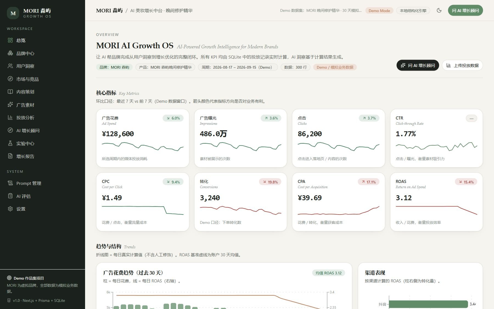

> 截图均来自本仓库真实运行的页面（1440×900，Chrome 实拍）。完整截图见 [`public/portfolio`](public/portfolio)。

---

## Portfolio · 求职作品集 Case Study

> **入口：`/portfolio`** → 本地运行后打开 <http://localhost:3000/portfolio>
> （单页视觉型 Case Study，独立于工作台布局，不影响 MORI 主产品任何功能）

作品集定位：**商科背景 × AI 应用 × 产品运营 × 数据分析 × 增长**，
面向 AI 产品运营 / AI 商业运营 / AI Growth / 市场与增长运营等岗位。

### 页面结构（14 节）

| 章节 | 内容 |
| --- | --- |
| 01 HERO | 标题、一句话介绍、核心数字（14 页面 / 7 Agent / 300 Demo 数据行 / 133 测试）、真实首页截图 |
| 02 Why I Built MORI | 增长工作的 7 步链路、5 个传统工作方式的问题、MORI 的 10 节点闭环解法 |
| 03 From Data to Decision | 8 个核心模块 × 真实页面截图（Market / Audience / Content / Creative / Campaign / Advisor / Experiment / Report） |
| 04 Market Intelligence | 价格 × 专业度矩阵、MORI 与 3 个虚拟竞品对比、市场空白与定位建议 |
| 05 Content Studio | 结构化输入维度 + 生成结果 + 「业务目标 → 内容策略 → 内容生成 → 投放测试」链路 |
| 06 Campaign Analytics | 10 个核心指标（真实计算值）+ 数据链路 + 「先算对数据，再让 AI 解释」的设计说明 |
| 07 AI Growth Advisor | 真实案例（CVR 3.96%→3.06%、ROAS 3.23→2.73、CPA →¥45.06、转化 739→593）+ **FACT / HYPOTHESIS / DATA GAP** + 行动建议 |
| 08 Experiment Lab | A/B 设计、主指标 CVR、辅助指标、z-test / 最小样本量 / 成功标准（全部标注 Simulated Experiment） |
| 09 AI Reliability | Structured Output / Failure Fallback / Data Provenance / Security 四张卡片 + 133 tests / TS 0 error / ESLint 0 problem |
| 10 Product Quality | 发布前验收结果（14/14 页面、7/7 后端交互、0 控制台错误、0 Key 泄露）+ Demo / AI / Fallback 三种状态 |
| 11 My Role | 我负责的部分（业务定义、产品结构、Agent 设计、Prompt、指标、实验、测试、迭代）+ 明确说明开发使用 Codex 辅助 |
| 12 What I Learned | 三点关于 AI 产品与业务决策的体会 |
| 13 Limitations | 诚实的边界说明（Demo 数据、无真实平台数据、无真实客户、SQLite、无登录）+ 下一阶段 Real Data → Real Traffic → Real Experiment |
| 14 Final | From Data to Insight to Action to Experiment + 姓名与目标岗位 |

### 截图资产

| 用途 | 位置 | 规格 |
| --- | --- | --- |
| 桌面端 | `public/portfolio/desktop/*.jpg` | 1440×900（deviceScaleFactor 1.25），16 张 |
| 移动端 | `public/portfolio/mobile/*.jpg` | 390×844（deviceScaleFactor 2），8 张 |

重新生成截图（需先启动 `npm run dev`）：

```bash
npm run screenshots
```

脚本会先真实点击关键页面的 AI 按钮并等待结果渲染，再截图；默认使用本机 Chrome，
也可用 `CHROME_PATH` / `SCREENSHOT_BASE` 环境变量覆盖。

### 导出 PDF

1. 打开 <http://localhost:3000/portfolio>
2. 点右上角 **「导出 PDF」**（等价于浏览器打印）
3. 在打印窗口里选择 **目标：另存为 PDF**，勾选 **背景图形**，边距选「默认」，建议**纵向 A4**
4. 保存即可（导航、按钮、放大遮罩会被自动隐藏，卡片与截图不会被拆页）

---

## Features

### 1. 总览 Dashboard

- 8 个核心指标卡（含环比与趋势迷你图）：广告花费 ¥128,600 / 曝光 4,860,000 / 点击 86,200 / CTR 1.77% / CPC ¥1.49 / 转化 3,240 / CPA ¥39.69 / ROAS 3.12
- 图表：花费趋势、ROAS 趋势、CTR/CVR 趋势、渠道表现、分人群效率
- **AI 增长洞察**：结论来自“真实计算结果 + 结构化 AI 分析”
- 素材表现排行榜（CTR 指数 + 放量 / 优化 Hook / 修复承接 / 暂停 四象限诊断）
- AI 分析历史（每次分析都会写入数据库，可复盘）

### 2. 品牌中心 Brand Center

品牌定位、核心产品（¥169 / 40ml）、卖点解释、使用场景、品牌关键词、渠道、人群摘要、品牌资产盘点与合规说明。

### 3. 用户洞察 Audience Intelligence

- 3 个 Persona：熬夜型都市新人 / 学生党护肤用户 / 轻熟稳定肌用户（痛点、动机、内容偏好、购买阻力、购买驱动）
- 5 个分人群投放切片（CTR / CVR / CPA / ROAS / 转化占比）
- **AI 分析用户** → 输出「用户机会 / 内容机会 / 产品机会 / 广告机会」四张卡片 + 推荐广告角度

### 4. 市场与竞品 Market Intelligence

- 价格 × 品牌专业度二维矩阵（MORI 与 3 个虚拟竞品）
- 竞品数据对比（价格/定位/用户/渠道/广告主题/强弱项）+ 内容主题拥挤度
- **生成 AI 竞品报告** → Insight / Opportunity / Risk / Recommendation + 市场空白 + 定位建议

### 5. 内容策划 Content Studio

- 选择平台（小红书/抖音/公众号）× 内容类型 × 目标 × 主题 × 人群
- 输出：5 个标题（含角度与“为什么有效”）、真实口吻正文、抖音 15 秒脚本（0–3s Hook / 3–8s 痛点 / 8–12s 方案 / 12–15s CTA）
- 内容评分：Hook / Relevance / Conversion Potential / Brand Fit / Overall + “为什么值得测试”“怎么进一步优化”
- 一键保存到内容库（写入数据库）

### 6. 广告素材中心 Creative Lab

- 一次生成 5 个**结构性差异**的素材方向（场景痛点 / 肤感实测 / 价格解释 / 信任记录 / 专业解释）
- 每个方向：角度、核心 Hook、时间轴脚本、CTA、目标人群、测试优先级与理由

### 7. 投放分析 Campaign Analytics

- **CSV 上传**（拖拽 / 选择文件 / 直接粘贴），自动清洗并写入数据库
- 自动计算 CTR / CPC / CVR / CPA / ROAS（除 0 保护）
- 素材效率明细、广告计划表现、每日趋势
- **AI Analyze Campaign** → Diagnosis / Main Reason / Hypotheses / Winners / Losers / Budget Moves / Experiments

### 8. AI 增长顾问 AI Advisor

带业务上下文的“顾问式”问答（不是普通聊天窗口），固定输出结构：
`Diagnosis → Main Reason → Hypothesis（含证据与置信度）→ Recommendation → Experiment → 数据依据`

### 9. 实验中心 Experiment Lab

- 选择两个真实素材作为 A / B 变体 → 系统用 **双比例 z 检验**（Two-proportion z-test）判断差异是否显著
- 输出：CTR / CVR / CPA / ROAS 对比、置信度、p 值，以及“建议保留 A / B / 继续收集样本”的结论

### 10. 增长报告 Growth Report

- 一键生成 8 段式周报：Executive Summary / Performance / Audience / Content / Campaign / Key Insights / Recommendations / Experiments
- 支持复制 Markdown、下载 `.md`、**下载 PDF**（客户端生成，无需服务端依赖）
- 历史报告入库（Report 表）

### 11. Prompt 管理 Prompt Library

6 个 Agent + 1 个报告 Agent 的独立 Prompt、版本号、输出 Schema（可展开/复制）、变更记录。

### 12. AI 评估 Evaluation

Completeness / Relevance / Actionability / Accuracy 四维评分 + 评估方法说明 + 已知局限（明确标注为 Demo Evaluation）。

### 13. 设置 Settings

AI Provider、Demo Mode、API Status（可测试连接）、Model、Theme（浅色/深色）、Data Management（重建 Demo 数据 / 清除上传数据集）。

### 14. 交互与错误处理

所有异步按钮都有 `Loading / Success / Error / Empty / Disabled` 五种状态；覆盖 API Key 缺失、AI 调用失败、
CSV 格式错误、CSV 空文件、数字字段为空、除数为 0、数据库错误与网络错误。

---

## Campaign Analytics（数据分析能力）

**设计原则：先把数据算对，再让 AI 做解释 —— 不让 AI 成为"数据真值"的来源。**

指标口径只在一处定义（`src/lib/metrics.ts`），全部带除 0 保护，可被原始 SQL 复核：

| 指标 | 公式 |
| --- | --- |
| CTR | clicks / impressions |
| CPC | spend / clicks |
| CVR | conversions / clicks |
| CPA | spend / conversions |
| ROAS | revenue / spend |

数据链路：

```text
CSV 上传 → Data Cleaning → Metric Calculation → Trend Analysis
        → Platform / Creative / Audience 三种切面 → AI Diagnosis
```

三种切面都来自同一份明细，不会出现口径打架：

| 切面 | 用途 | Demo 数据示例 |
| --- | --- | --- |
| 素材级 | 找高效 / 低效素材，决定加预算还是止损 | 「熬夜党晚间修护」CTR 2.41% / ROAS 4.26；「成分党深度解析」CTR 1.21% / ROAS 2.13 |
| 渠道级 | 看 CPC 与转化贡献的结构差异 | 抖音 / 小红书 / 信息流广告三个渠道的 CPC、CVR、转化占比 |
| 人群级 | 看"有兴趣"与"会购买"的差距 | 18–24 岁女性 CTR 高但 CVR 低于 25–30 岁女性 |

AI 只负责解释与建议（诊断 / 假设 / 预算调整 / 下一轮实验），并且必须引用上面这些计算结果作为证据。
总览页的 8 个 KPI 也全部由数据库实时计算 —— 修改 Demo 数据，Dashboard 会随之变化。

---

## Experiment Lab（实验能力）

把"我觉得 B 更好"变成可检验的实验设计：

| 项 | 内容 |
| --- | --- |
| 变体 | A / B 直接取自当前数据集中的素材记录（Demo 数据） |
| 主指标 | CVR（比例型指标 → 双比例 z 检验） |
| 辅助指标 | CPA / ROAS；建议补埋点：首屏滚动率 / 加购率 / 支付成功率 |
| 统计方法 | two-proportion z-test：输出 z 值、p 值、置信度与是否显著 |
| 样本量 | 内置最小样本量估算（例如 +15% 相对提升、α=0.05、power=0.8） |
| 结论形态 | 「建议保留 A / B 继续测试」或「差异未达显著，继续收集样本」 |

> ⚠️ **所有实验均为 Demo / Simulated Experiment。** 结论只回答"是否值得继续测试"，
> 表述必须是「基于模拟数据推演，B 方向表现更优，但仍需真实流量验证」，
> **不会**写成「实验已经证明 B 有效」，也不宣称任何真实业务结果。

实验记录会写入数据库，可在下次复盘时对照假设与实际表现。

---

## Architecture

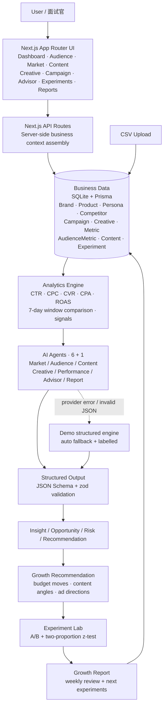

### 为什么这样分层

- **数据层不依赖 AI**：所有 KPI 先由 `lib/metrics.ts` / `lib/analytics.ts` 算出来，AI 只是“解释与决策层”。
  这样即使模型胡说，也骗不过 Dashboard。
- **AI 层只有两个出口**：符合 Schema 的结构化对象，或者带警告的回退结果。没有第三种状态会到达前端。
- **回退是产品能力**：Demo Mode 不是“降级”，而是让评审在没有任何 Key 的情况下也能看到完整闭环。

---

## Tech Stack

| 层 | 选型 | 说明 |
| --- | --- | --- |
| Framework | Next.js 15.5（App Router） | 服务端组件取数 + API Routes 处理 AI/上传 |
| Language | TypeScript 5.9（strict） | `tsc --noEmit` 通过 |
| UI | Tailwind CSS 3.4 + shadcn/ui 风格组件（本地内置） | 不依赖远程字体，离线可跑 |
| Charts | Recharts 2.15 | 图表颜色随主题切换 |
| Database | SQLite + Prisma 6 | `prisma/dev.db`，随仓库提供已 seed 的 Demo 数据 |
| AI | OpenAI-compatible `/chat/completions` + Structured Outputs | `lib/ai/client.ts` 使用原生 fetch + JSON Schema |
| Validation | zod 3 | 同时用于生成 JSON Schema 与校验模型输出 |
| Tests | Vitest 3 | 133 个用例 / 14 个文件（指标 / CSV / 数据 / 分析 / 统计 / AI 结构 / AI 请求契约 / DeepSeek / 额度与并发 / IP Planner / 模拟数据表述规范） |
| PDF | jsPDF（客户端） | 周报 PDF 导出 |

---

## AI Architecture

### 6 个专职 Agent（故意不使用一个大 Prompt）

| Agent | 职责 | 输出 Schema | 版本 |
| --- | --- | --- | --- |
| Market Analyst | 市场与竞品分析 | `MarketAnalysisSchema` | v1.2 |
| Audience Analyst | 用户洞察与机会 | `AudienceAnalysisSchema` | v1.3 |
| Content Strategist | 内容策划与评分 | `ContentStrategySchema` | v1.4 |
| Creative Strategist | 广告素材方向 | `CreativeDirectionsSchema` | v1.2 |
| Performance Analyst | 投放数据分析 | `CampaignAnalysisSchema` | v1.5 |
| Growth Advisor | 最终商业建议 | `GrowthAdviceSchema` | v2.0 |
| Report Writer | 增长周报 | `GrowthReportSchema` | v1.1 |

完整 Prompt 见 [`prompts/`](prompts)（由 `src/lib/prompts.ts` 通过 `npm run prompts:export` 生成，避免文档与运行时漂移）。

### 结构化输出流程

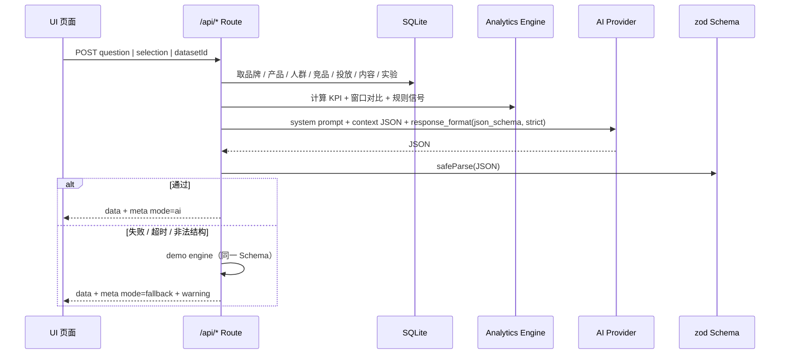

### Agent 输出的硬性约束（写入每个 Prompt）

1. MORI 是虚拟品牌，数据是模拟数据，禁止描述成真实业绩
2. 禁止编造商业成绩与功效承诺、绝对化表述
3. 只输出符合 JSON Schema 的结构化结果
4. 每条结论必须有 `evidence` 与 `confidence`
5. 先判断、再证据、最后可执行动作
6. 数据不足时必须回答“数据不足”，并说明需要补什么数据
7. **数据真实性与表述规范**：所有实验 / 投放 / 人群数据都是模拟数据。允许基于模拟数据推演，
   但必须写成「模拟实验结果」「Demo 数据显示」「基于模拟数据推演」；禁止使用「已完成实验」「已验证」
   「实际提升 X%」「真实投放验证」「带来收入增长」这类把模拟当成既成事实的表述；缺少真实数据支持的判断
   必须写成「需要真实数据验证」。上传数据集时改用「基于上传的投放数据」口径。

---

## AI 可靠性设计（Structured Output · Fallback · Retry · Timeout）

这一节回答一个面试常见问题：**"如果模型不稳定，你的产品会怎样？"**

| 机制 | 实现 |
| --- | --- |
| Structured Output | 每个 Agent 先定义 JSON Schema（由 zod 单一事实来源生成），模型返回结构化对象，前端只渲染 Schema 内的字段 |
| 校验 | `zod` 全量强校验：字段缺失、`null`、类型错误都会被识别；**不静默修改业务数据**，也不会为了通过校验而放宽 required |
| 请求形状三级阶梯 | ① `json_schema`（strict）→ ② `json_object` + 把 JSON Schema 与「必填字段清单」注入 prompt → ③ 纯 JSON + 同样注入。DeepSeek 等不支持 strict 的 provider 直接走 ②，不浪费一次必然失败的请求 |
| strict 兼容处理 | 发往模型的 Schema 会自动剔除 strict 不支持的字段（`minimum` / `maximum` / `pattern` / `default` …），但 zod 仍按原始规则校验返回值 |
| 修复式重试 | 校验失败时把「缺失 / 类型错误清单」回灌给模型重问（同形状最多 2 次）；`finish_reason=length` 截断时触发"更精简"重试，而不是直接判失败 |
| 解析容错 | 自动处理 ` ```json ` 代码块围栏、前后夹杂说明文字、尾逗号等语法问题（只修语法，不改内容） |
| 错误分类与兜底 | `MISSING_API_KEY` / `NETWORK_ERROR` / `TIMEOUT` / `HTTP_ERROR` / `EMPTY_RESPONSE` / `TRUNCATED` / `INVALID_JSON` / `REFUSED` → **模型错误自动回退到本地 Demo 引擎**，并标注 `AI 失败 · 已回退`；额度与频率限制返回明确的 HTTP 429，不会被伪装成成功结果 |
| 密钥安全 | API Key 只在服务端读取；前端产物既没有 Key 也没有 Provider 域名（已扫描确认）；错误文案统一脱敏为 `sk-***` |
| 可验证性 | `npm run mock:provider` 提供本地 OpenAI-compatible mock，可用 `MOCK_MODE=http500` / `MOCK_MODE=badjson` 主动制造故障，验证 fallback 链路；133 个测试中包含 AI 额度、并发与可靠性用例 |

---

## Data Model

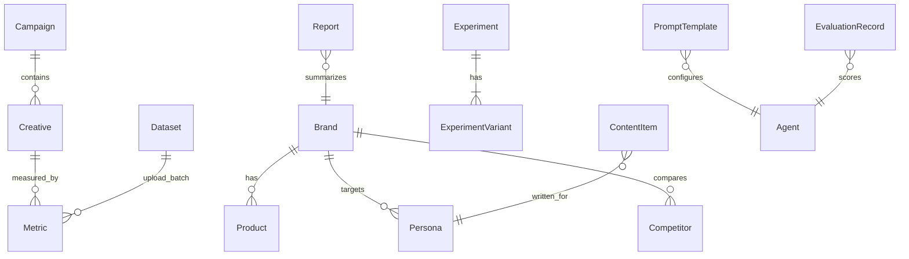

主要表：`Brand` `Product` `Persona` `Competitor` `Campaign` `Creative` `Metric`（投放明细）`AudienceMetric`（分人群切片）
`Dataset`（上传批次）`ContentItem` `Experiment` + `ExperimentVariant` `Insight` `Report` `PromptTemplate` `EvaluationRecord` `Setting`。

Demo 数据规模（`npm run db:seed`）：

| 数据 | 数量 |
| --- | --- |
| 投放记录 Metric | **300 条**（30 天 × 10 条素材） |
| 分人群记录 AudienceMetric | **150 条**（30 天 × 5 个人群） |
| Persona | 3 个 |
| 虚拟竞品 | 3 个（+ MORI 自身） |
| Campaign | 5 个 |
| Creative | 10 条 |
| 内容 ContentItem | **36 条** |
| 实验 Experiment | 3 个（含 A/B 变体） |
| Prompt | 7 个 |
| 评估记录 | 6 条 |

---

## Screenshots

| 页面 | 截图 |
| --- | --- |
| 首页 Landing | 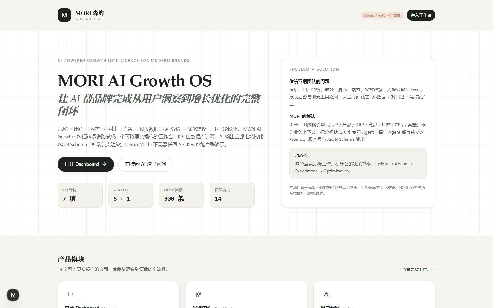 |
| 总览 Dashboard |  |
| AI 增长洞察 | 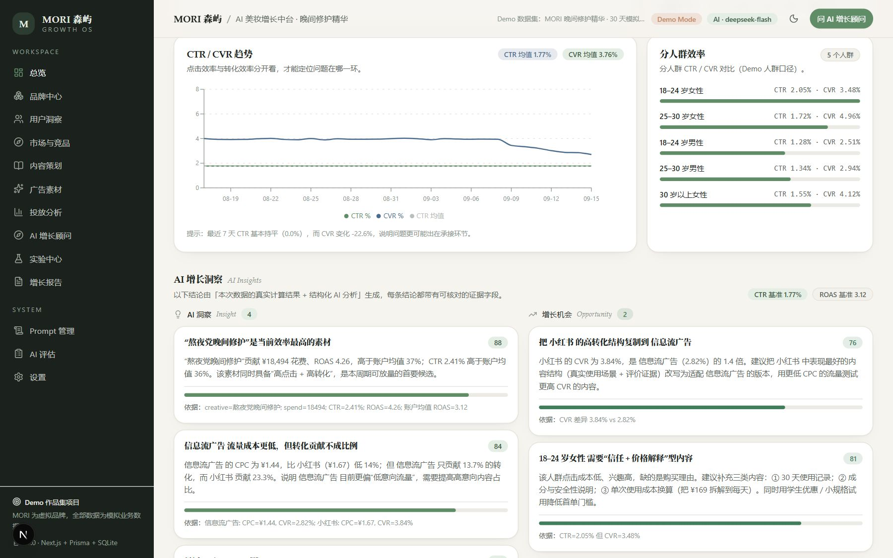 |
| 市场与竞品 Market | 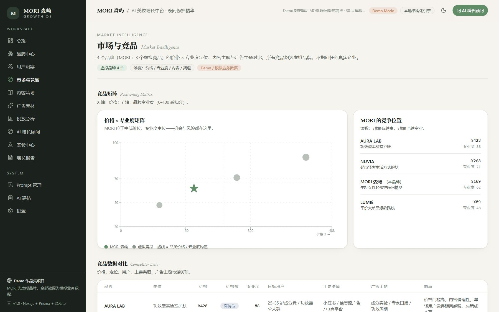 |
| 内容策划 Content | 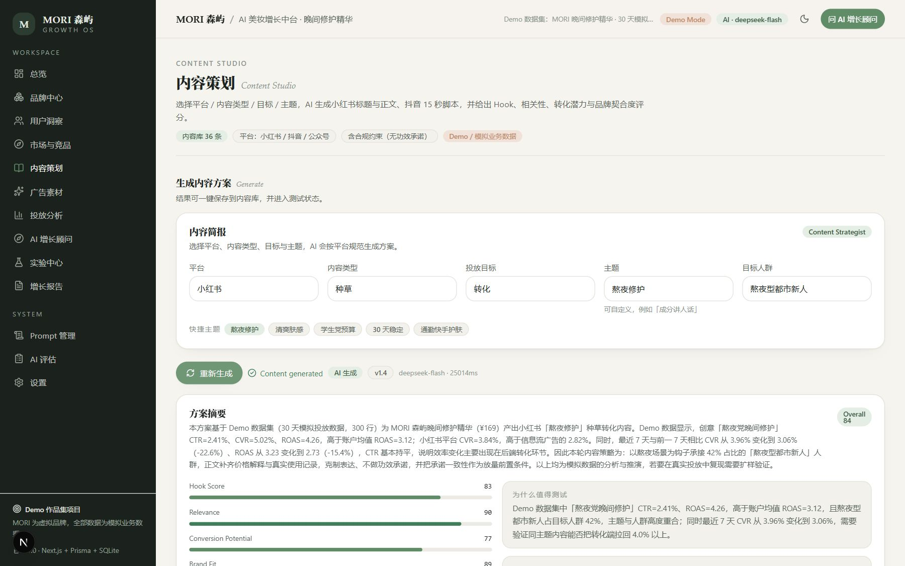 |
| 广告素材 Creative | 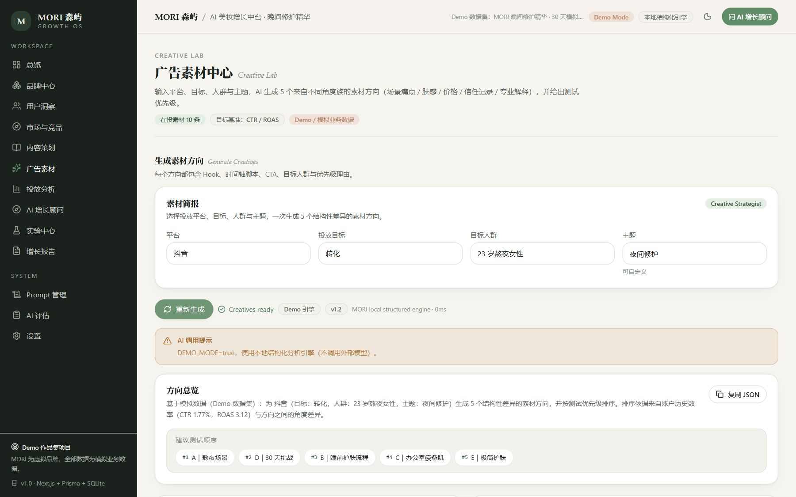 |
| 投放分析 Campaign | 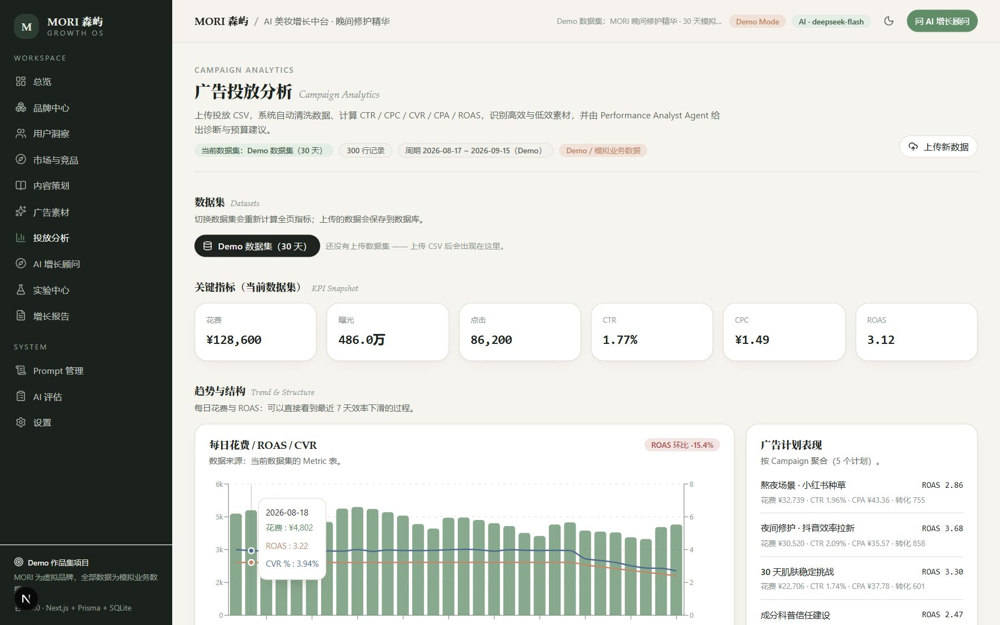 |
| 用户洞察 Audience | 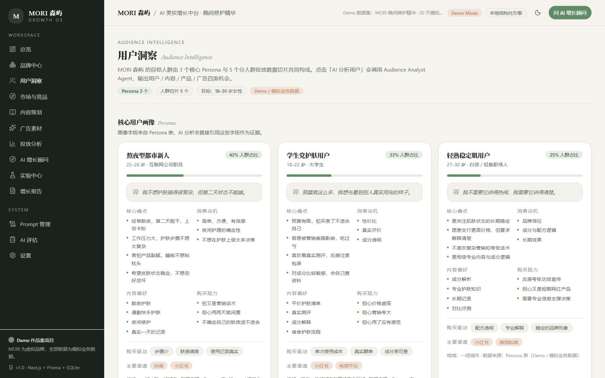 |
| AI 增长顾问 Advisor | 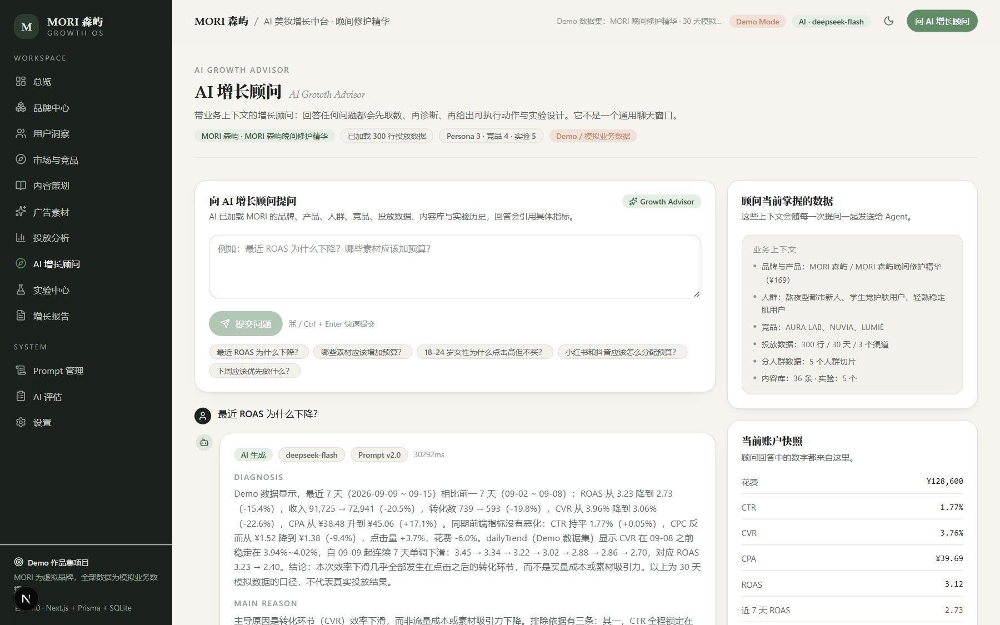 |
| 实验中心 Experiments | 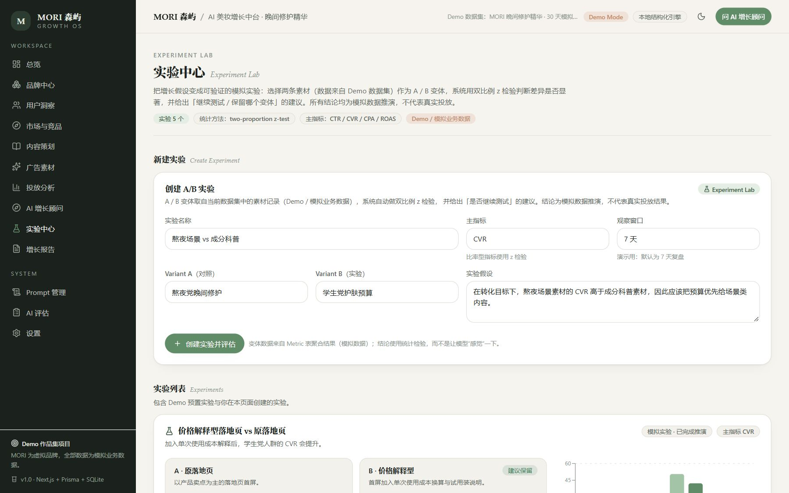 |
| 增长报告 Reports | 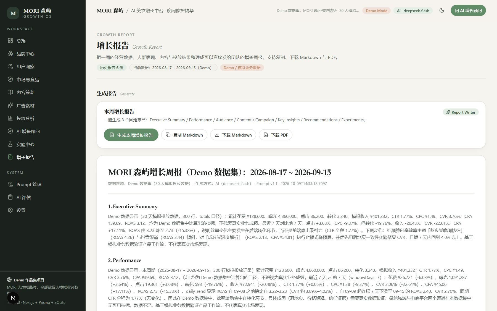 |
| 设置 / AI 状态 | 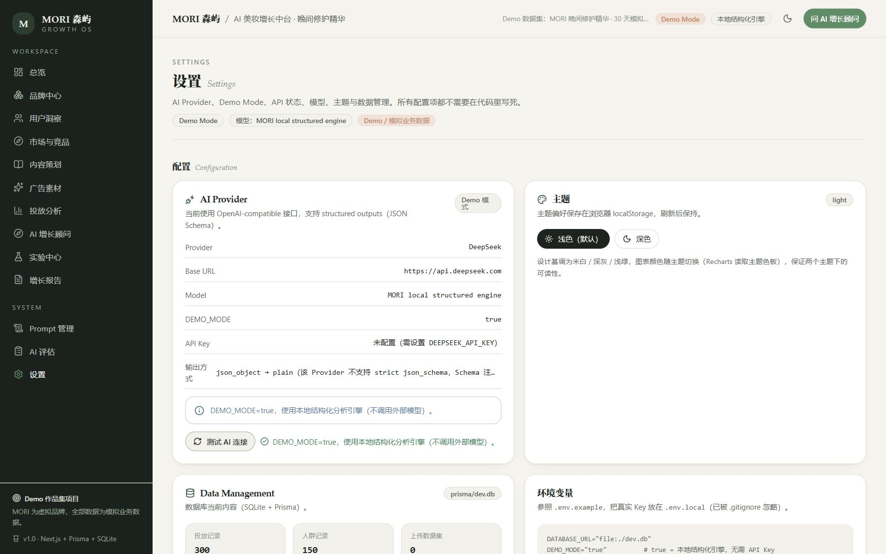 |
| Prompt 管理 | 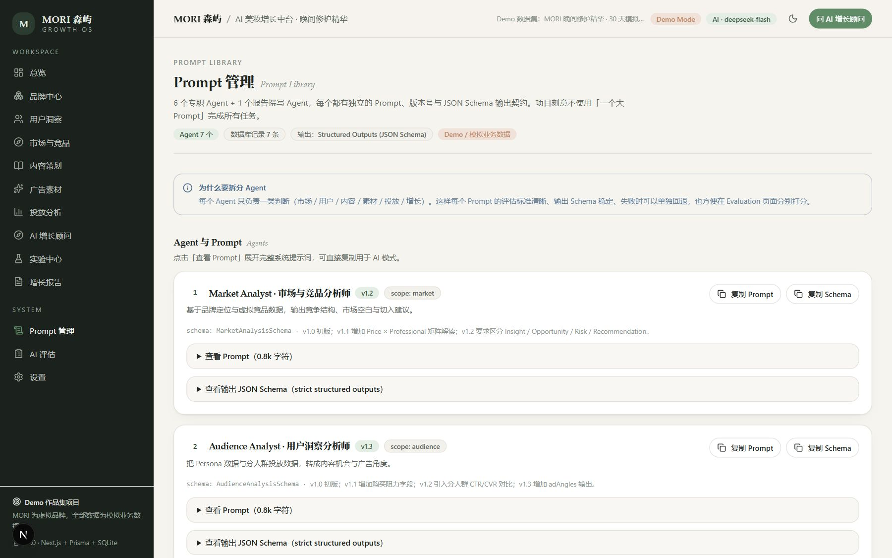 |
| AI 评估 | 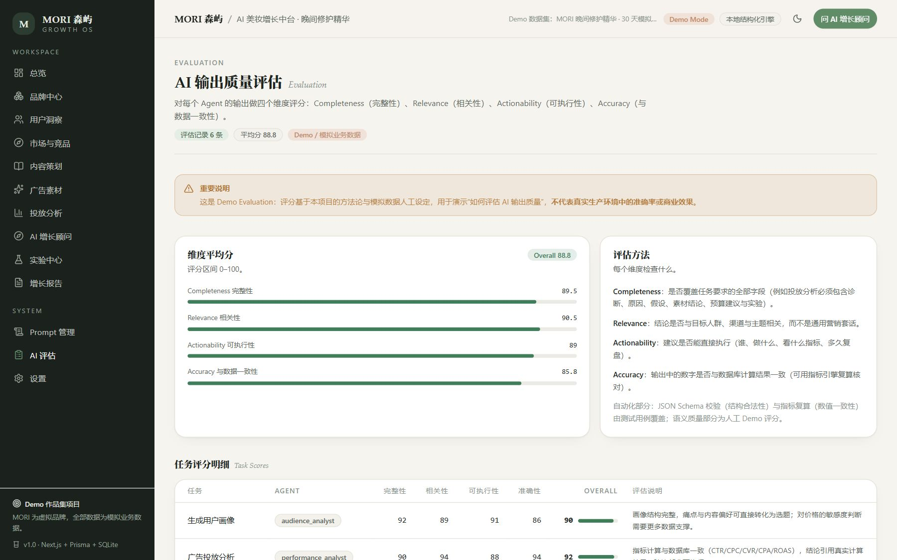 |
| 品牌中心 | 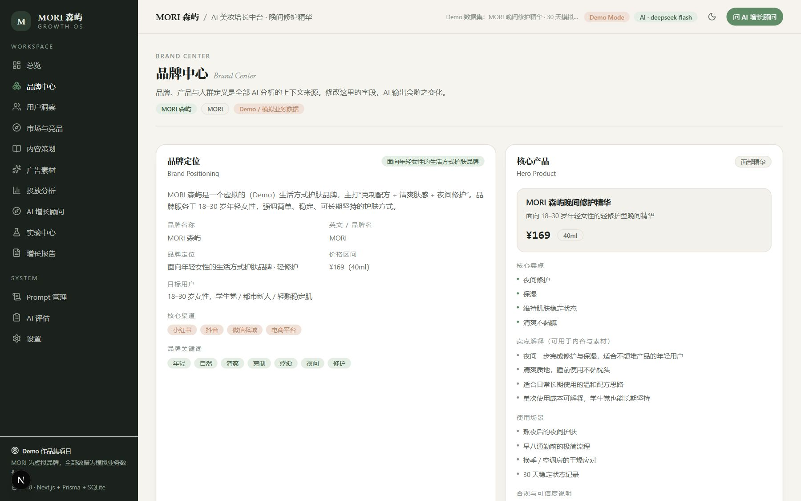 |
| 深色主题 | 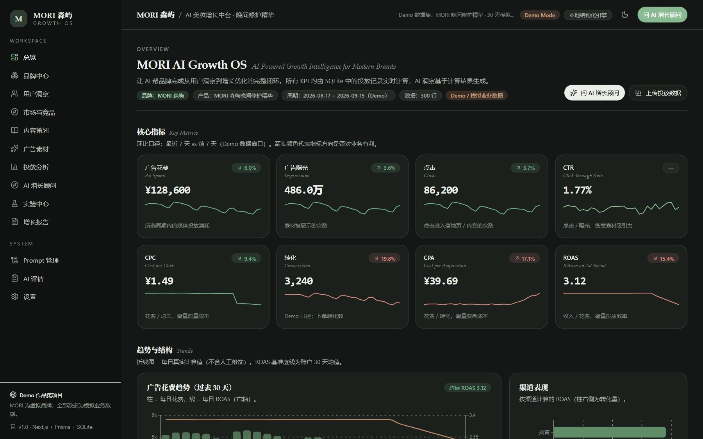 |
| 移动端（390×844） | 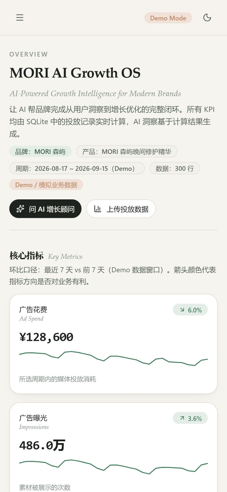 |

---

## Getting Started

### 环境要求

- Node.js **≥ 20**（开发验证使用 Node 24）
- 包管理器：`npm`（推荐）或 `pnpm`

### 安装与启动

```bash
# 1) 安装依赖（会自动执行 prisma generate）
npm install

# 2) 初始化数据库 + 写入 Demo 数据（首次必须执行一次）
npm run db:setup

# 3) 启动
npm run dev
```

打开 <http://localhost:3000> 即可看到完整产品。

> 仓库内已附带 seed 好的 `prisma/dev.db`，因此如果你只想先看效果，可以直接 `npm install && npm run dev`；
> 想重建数据则执行 `npm run db:reset`。
>
> 使用 pnpm 时命令相同：`pnpm install && pnpm run db:setup && pnpm run dev`。

### 在没有 npm 的机器上运行（开发验证环境就是这种情况）

如果机器上只有 Node（本机 Node 24）而 PATH 里没有 `npm`，可以直接用随 Codex 运行时附带的 pnpm，
并关闭 Next 遥测（该机器上遥测写配置会因 EXDEV 报错并中断启动）：

```powershell
$pnpm = 'C:\Users\<you>\.cache\codex-runtimes\codex-primary-runtime\dependencies\node\node_modules\pnpm\bin\pnpm.cjs'
$env:NEXT_TELEMETRY_DISABLED = '1'
node $pnpm exec next dev -p 3000       # 等价于 npm run dev
```

需要完整命令（含 db / test / build）时，把 `npm run <script>` 换成 `node $pnpm run <script>` 即可。
最省事的方案仍然是安装 [Node.js LTS](https://nodejs.org/)（自带 npm），之后按上面的标准流程运行。

> 双击项目根目录的 **`start-mori.cmd`** 也可以一键启动：它会自动设置 `NEXT_TELEMETRY_DISABLED=1`、
> 自动打开浏览器，并且在服务已经在运行时只打开浏览器而不重复启动（有 npm 就用 npm，没有就用本机 Codex 运行时自带的 pnpm）。

### 常用命令

| 命令 | 作用 |
| --- | --- |
| `npm run dev` | 启动开发服务器（http://localhost:3000） |
| `npm run build` / `npm start` | 生产构建与启动 |
| `npm run db:setup` | `prisma db push` + `tsx prisma/seed.ts` |
| `npm run db:reset` | 强制重建数据库并重新写入 Demo 数据 |
| `npm run db:studio` | Prisma Studio 可视化查看数据库 |
| `npm run typecheck` | TypeScript 类型检查（`tsc --noEmit`） |
| `npm run lint` | ESLint（flat config, next/core-web-vitals） |
| `npm test` | Vitest 单元测试（133 个用例） |
| `npm run verify` | typecheck + lint + test |
| `npm run prompts:export` | 从源码重新生成 `prompts/*.md` |
| `npm run mock:provider` | 启动本地 OpenAI-compatible mock（验证真实 AI 模式与 fallback） |
| `npm run bundle` | 重新生成单文件纯文本包（用于上传给 ChatGPT 等） |
| `npm run screenshots` | 重新生成作品集截图（桌面 1440×900 + 移动 390×844，需先 `npm run dev`） |

### 默认登录方式

**无需登录**。这是一个求职作品集项目，按需求刻意不做登录 / 权限 / 支付系统（避免过度工程化）。

---

## Environment Variables

复制 `.env.example` 为 `.env.local` 后按需修改（`.env.local` 已被 `.gitignore` 忽略，不会被提交）：

```bash
DATABASE_URL="file:./dev.db"                    # SQLite 数据库位置（相对 prisma/）

DEMO_MODE="true"                                # true = 公开 Demo，每位访客最多 5 次真实模型调用
DEEPSEEK_API_KEY=""                             # 只在服务端读取；真实值放 .env.local，不要提交
AI_PROVIDER="deepseek"
DAILY_AI_LIMIT="100"
AI_RATE_LIMIT_PER_MINUTE="10"
AI_MAX_INPUT_CHARS="60000"
AI_MAX_TOKENS="4096"
AI_REQUEST_TIMEOUT_MS="120000"
```

**任何 API Key 都不会出现在代码或前端 bundle 中**：所有模型调用都发生在服务端 API Route 内。

## Public Demo / 本地开发模式

- `DEMO_MODE=true`：公开 Demo 模式。配置 Key 时会真实调用模型，但每位匿名访客最多成功调用 5 次，并受每日全局额度保护；没有 Key 时自动使用本地结构化分析引擎。
- `DEMO_MODE=false`：本地开发模式。配置 Key 时不限制个人体验次数，适合本人调试（不要在 Railway 公开环境使用）。
- 它**不是写死的答案**：每句话都由刚算出来的指标拼装（例如“「熬夜党晚间修护」贡献 ¥18,486 花费、ROAS 4.26，高于账户均值 37%”），
  所以**改 Demo 数据或上传自己的 CSV，分析结论会跟着变**。
- 页面顶部显示剩余体验次数；HttpOnly Cookie 标识匿名访客，前端无法读取访客 ID。

## AI Mode

1. 在 `.env.local` 设置 `DEMO_MODE="false"`、`AI_PROVIDER="deepseek"` 与 `DEEPSEEK_API_KEY="<your-key>"`
2. 重启 `npm run dev`
3. 顶部状态变为 `AI · <model>`，Settings → AI Status 可点击「测试 AI 连接」

### DeepSeek（推荐配置，已内置 Provider 预设）

MORI 支持按预设切换 Provider，**DeepSeek 只需一个环境变量 + 你的 Key**（Key 放在 `.env.local`，已被 git 忽略）：

```bash
# .env.local  （绝对不要提交到 Git）
DEMO_MODE="false"
AI_PROVIDER="deepseek"                 # 预设：base URL + model 自动带上
DEEPSEEK_API_KEY="sk-你的 DeepSeek Key"  # 只在服务端读取

# 可选覆盖
AI_MODEL="deepseek-flash"              # 若你的账号是 deepseek-chat，改这里即可（无需改代码）
AI_TEMPERATURE="0.4"                   # 设 "default" 则完全不发送该参数
AI_MAX_TOKENS="4096"                   # 输出上限，代码硬性封顶 8192
```

| 项 | 值 |
| --- | --- |
| Provider 预设 | `AI_PROVIDER="deepseek"` |
| Base URL | `https://api.deepseek.com`（预设自带，请求路径为 `/chat/completions`） |
| Model | `deepseek-flash`（预设默认，可用 `AI_MODEL` 覆盖） |
| API Key 环境变量 | **`DEEPSEEK_API_KEY`**（也接受通用 `AI_API_KEY`；OpenAI 用 `OPENAI_API_KEY`） |
| 输出方式 | DeepSeek 不支持 strict `json_schema`，因此**直接使用 `json_object` + 把 JSON Schema 注入 system prompt**，再由 zod 校验（跳过无效的 strict 尝试，省一次往返） |

> 若 DeepSeek 返回 `Model Not Exist`，说明你的账号可用模型名不同（官方公开名称为 `deepseek-chat` /
> `deepseek-reasoner`），把 `AI_MODEL` 或 `OPENAI_MODEL` 改成可用的名字即可，**不需要改代码**。

Settings → AI Provider 卡片会显示当前的 Provider / Base URL / Model / **密钥来源（只显示变量名）** /
输出方式，点「测试 AI 连接」可以确认 DeepSeek 是否真的连通（成功时会回显 `DeepSeek · 请求方式 json_object`）。

调用使用官方 Structured Outputs 形式：

```json
{
  "response_format": {
    "type": "json_schema",
    "json_schema": {
      "name": "mori_campaign_analysis",
      "strict": true,
      "schema": { "...": "由 zod 自动生成（additionalProperties:false + required 全覆盖）" }
    }
  }
}
```

任何模型调用失败（无 Key / HTTP 错误 / 超时 / JSON 非法 / Schema 不符 / 模型拒答）都会：

1. 回退到 Demo 引擎（同一套 Schema）；
2. 在前端标注 `AI 失败 · 已回退` 与具体原因；
3. 绝不把非法结构渲染到页面。

额度限制是例外：体验次数或每日额度用完时返回 HTTP 429，不会继续请求模型，也不会偷偷回退成一次成功体验。

### 匿名额度与全局保护

- 访客 ID 由 Middleware 生成随机 UUID，并写入 `HttpOnly; SameSite=Lax; Secure(生产)` Cookie。
- 所有真实模型请求最终都经过 `src/lib/ai/client.ts` 和 `src/lib/ai/usage.ts`，Route 无法绕过。
- `AiVisitorUsage` 原子预约 `successCount + inFlightCount` 槽位：最多 5 个并发请求；只有 Schema 合法的模型响应才增加成功次数，失败会释放预约。
- `AiDailyUsage` 在每次出站请求前原子计数，达到 `DAILY_AI_LIMIT` 后全站暂停 AI 请求。
- 单次请求同时限制输入字符数、最大输出 token、超时和每访客每分钟请求数。

### 请求形状降级阶梯（兼容所有 OpenAI-compatible 服务）

不同厂商对 `response_format` 的支持程度不一样，所以客户端会从强到弱依次尝试，**校验强度不降级**（每一步都仍用 zod 校验）：

| 顺序 | 请求形状 | 何时使用 | temperature / max_tokens |
| --- | --- | --- | --- |
| 1 | `json_schema`（strict Structured Outputs） | 默认首选 | 发送 |
| 2 | `json_object` + 把 JSON Schema 注入 system prompt | 仅当上游对 1 返回 400/404/405/415/422 | 不发送 |
| 3 | 纯 JSON 输出 + 把 Schema 注入 prompt | 仅当 2 仍然失败 | 不发送 |

其他已处理的真实兼容性问题：

- **strict 模式合规**：发往模型的 JSON Schema 会自动剔除 strict 不支持的字段（`minimum` / `maximum` / `pattern` / `default` …），
  但 zod 仍然用原始规则校验返回值 —— 否则 OpenAI 会直接返回 400，导致每个 Agent 都静默 fallback。
- **代码块围栏**：模型返回 ` ```json … ``` ` 或前后包着一句话时，会自动去围栏 / 提取花括号内容。
- **推理模型**：设 `AI_TEMPERATURE="default"` 可完全不发送 `temperature`（gpt-5 / o 系列会拒绝该参数）。
- **截断**：`finish_reason=length` 会报 `TRUNCATED` 并尝试更轻的请求，而不是含糊地报"不是合法 JSON"。
- **密钥安全**：所有错误文案、日志、API 响应都会经 `redactSecrets()` 脱敏（`sk-***` / `Bearer ***`），Key 只存在于服务端请求头。

### 没有真实 Key 也能验证真实 AI 模式

```bash
npm run mock:provider                      # 本地 OpenAI-compatible mock（ok 模式）
MOCK_MODE=http500 npm run mock:provider     # 模拟上游故障 → 验证 fallback
MOCK_MODE=badjson npm run mock:provider     # 模拟非 JSON 输出 → 验证 Zod 校验 + fallback
```

然后把 `.env.local` 指向它：`DEMO_MODE="false"`、`OPENAI_API_KEY="sk-local-mock"`、
`OPENAI_BASE_URL="http://127.0.0.1:8787/v1"`、`OPENAI_MODEL="mock-model"`，
就可以在不消耗任何真实额度的情况下验证 7 个 Agent 的真实调用链路。

---

## Deployment（Railway）

> 状态：线上地址以 Railway 项目为准；本仓库未保存可访问域名或部署凭据。修改完成后需推送并重新部署才会生效。

### 已完成的部署前验证

| 检查 | 结果 |
| --- | --- |
| production build | ✅ `next build` exit 0（5 个静态页预渲染 + 28 条动态路由） |
| 生产模式实测 | ✅ `next start` 本地运行：16 个页面全部 HTTP 200，CSV 上传写库成功 |
| TypeScript / ESLint | ✅ 0 error / 0 problem |
| 自动化测试 | ✅ 133 passed（14 个测试文件） |

### 关键结论：为什么选择 Railway 而不是 Vercel

项目使用 **SQLite** 作为数据库，而 Vercel 的运行时文件系统只读（除 `/tmp`），
会导致 11 个写数据库的接口失败（6 个 AI 分析接口 + CSV 上传 + 内容保存 + 创建实验 + 生成报告 + 数据管理）。
因此选择**带持久磁盘的 Node 主机**（Railway / Render / Fly.io / 自建 VPS），**不需要迁移到 Postgres**。

### Railway 最小配置

| 配置项 | 值 |
| --- | --- |
| Build Command | `npm run build` |
| Start Command | `npm run start:railway`（先执行只增量建表的 `prisma db push`，再启动服务） |
| Healthcheck Path | `/api/health`（返回 AI 模式 + 数据库行数） |
| Node 版本 | ≥ 20（推荐 22，可用 `NIXPACKS_NODE_VERSION=22`） |
| 包管理器 | pnpm（仓库内 `pnpm-lock.yaml` 会自动被识别） |
| Volume | 挂载到 `/data`（写入持久化的前提） |
| `DATABASE_URL` | 无 Volume：`file:./dev.db`（用仓库自带已 seed 的 Demo 库）<br>有 Volume：`file:/data/mori.db` |
| `DEMO_MODE` | `true`（公开访问 + 每位访客最多 5 次真实 AI；Railway 环境变量优先级高于仓库 `.env`） |
| 初始化数据库 | `start:railway` 会安全地为已有库补建 AI 额度表，不重置业务数据。**仅首次空 Volume** 需手动执行一次 `npm run db:setup`；该命令会重建 Demo 数据，之后不要重复执行 |

### 开启公开真实 AI（受 5 次 + 每日 100 次保护）

只需在 Railway 的 **Environment Variables** 里添加（**绝不写入仓库**）：

```bash
DEMO_MODE="true"
AI_PROVIDER="deepseek"
DEEPSEEK_API_KEY="<你的 Key>"
AI_MODEL="<你的账号可用模型名>"
DAILY_AI_LIMIT="100"
AI_RATE_LIMIT_PER_MINUTE="10"
AI_MAX_INPUT_CHARS="60000"
AI_MAX_TOKENS="4096"
AI_REQUEST_TIMEOUT_MS="120000"
```

仓库的 `.env.production` 已提供其余非敏感生产默认值，因此 Railway 至少只需把 `DEEPSEEK_API_KEY` 添加为 Secret，并确认 `DATABASE_URL` 指向持久 Volume。若只设置 `DEEPSEEK_API_KEY`，代码也会自动选择 DeepSeek。

`DATABASE_URL` 必须指向挂载到 `/data` 的 SQLite Volume，例如 `file:/data/mori.db`。否则 Railway 重启后访客额度会丢失。
配置后可在 Settings → AI Provider 点「测试 AI 连接」验证；该探针也计入一次真实 AI 体验。

仓库内的 `railway.json` 已固定上述 Start Command 和 `/api/health` 健康检查；Railway 仍需要一个持久 Volume 和环境变量。

---

## Testing

```bash
npm test           # 133 passed / 14 files
npm run typecheck  # 0 error
npm run lint       # 0 problem
```

| 测试文件 | 覆盖内容 |
| --- | --- |
| `tests/metrics.test.ts` | CTR / CPC / CVR / CPA / ROAS 公式、除 0、NaN/Infinity、空数据集、格式化 |
| `tests/csv.test.ts` | CSV 解析（引号 / 转义 / CRLF / BOM）、中文表头别名、¥ 与千分位、空文件、缺列、坏日期、空数字、口径异常、round-trip |
| `tests/demo-data.test.ts` | KPI 目标精确命中、素材基准值、30 天结构、窗口对比、分人群再切分、整数分配器、占比求解器 |
| `tests/analytics.test.ts` | 日序列、渠道 / 素材聚合、窗口对比、四象限诊断、规则信号、空数据兜底 |
| `tests/statistics.test.ts` | 双比例 z 检验（显著 / 不显著 / 0 样本）、最小样本量 |
| `tests/ai-schema.test.ts` | **7 个 Agent 的结构化输出全部通过 Schema 校验**、JSON Schema 严格性（`additionalProperties:false` / `required`）、**7 类非法 AI 输出被拒绝**、越界置信度被拒绝、Provider 抛错时自动回退且结果仍合法、Prompt 合规约束检查 |
| `tests/ai-provider.test.ts` | 真实 AI 请求契约（16 个用例）：strict Schema 不含不被支持的字段、`json_schema → json_object → plain` 降级、温度可控、代码块围栏解析、截断与拒答处理、Key 脱敏 |

> 关于“AI 返回非法数据不会崩溃”：`tests/ai-schema.test.ts` 注入了会抛错的 provider，断言 `meta.mode === "fallback"`、
> 带有 `HTTP_ERROR` 警告，并且回退结果依然符合 Schema。

### 我的验证记录（本仓库实际执行）

| 检查 | 命令 | 结果 |
| --- | --- | --- |
| 类型检查 | `tsc --noEmit` | ✅ 0 error |
| Lint | `eslint .` | ✅ 0 problem |
| 单元测试 | `vitest run` | ✅ 133 passed / 14 files |
| 全部页面渲染 | `GET / /dashboard /brand /audience /market /content /creative /campaign /advisor /experiments /reports /prompts /evaluation /settings` | ✅ 全部 HTTP 200 |
| AI 接口 | `POST /api/{audience,market,content,creative,campaign,advisor,reports,experiments,settings}` | ✅ 全部 `ok:true`（Demo 引擎） |
| CSV 成功上传 | `POST /api/campaign/upload` | ✅ 3 行入库 + 3 条质量提示 |
| CSV 错误处理 | 空文件 / 缺列 / 无法解析日期 | ✅ `INVALID_REQUEST` / `MISSING_COLUMNS` / `NO_DATA_ROWS`，含行级 issues |
| 数据库 Seed | `tsx prisma/seed.ts` | ✅ 花费 ¥128,600 · CTR 1.77% · CPC ¥1.49 · CPA ¥39.69 · ROAS 3.12 |
| 真实 AI 模式（本地 mock provider 端到端） | 7 个 Agent + Settings 连通性测试 | ✅ 8/8 返回 `mode=ai`；请求全部为 `json_schema strict=true` 且 `strictViolations=none` |
| AI 失败回退 | mock 返回 500 / 非 JSON | ✅ 均返回 `mode=fallback` 并带 `HTTP_ERROR` / `INVALID_JSON` 原因，页面不崩溃 |
| 密钥泄漏检查 | 响应体 + 应用日志扫描 | ✅ 未出现 Key（错误文案已脱敏为 `sk-***`） |
| **真实 DeepSeek 连接** | Settings → 测试 AI 连接 | ✅ `ok=true`（deepseek-flash · 请求方式 json_object · 1.5s） |
| **真实 DeepSeek Agent 调用** | `POST /api/advisor/ask` | ✅ `mode=ai`（32s，结论引用了数据库真实指标并自行做了排除法推理） |
| DeepSeek 鉴权头回归 | `tests/ai-deepseek.test.ts` | ✅ 3 个用例（含"残留 OPENAI_API_KEY 不得覆盖 DeepSeek Key"场景） |
| 结构化输出完整性（真实 DeepSeek） | Content Studio ×5 | ✅ 5/5 `mode=ai`，`scores.howToImprove` / `whyTest` 每次都有内容（121–153 字） |
| 长输出 Agent（真实 DeepSeek） | Campaign Analytics ×2 | ✅ 2/2 `mode=ai`（21s / 17s；精简输出后由 205s 中断变为 ~20s 稳定完成） |
| 缺字段修复式重试 | `tests/ai-structured-output.test.ts` 等 | ✅ 12 个新用例（必填清单 / description / 修复重试 / null / 尾逗号 / 截断精简 / 超时与中断区分） |
| 模拟数据表述规范（真实 DeepSeek） | 顾问被问「实验跑完了吗 / 结论能直接用吗」 | ✅ 断言式违规 **0** 次；模型主动要求「复盘里写成方向性信号 + 待验证，不要写成『已验证』或『提升 17.5%』」 |
| 投放分析口径（真实 DeepSeek） | `POST /api/campaign/analyze` | ✅ 输出为「Demo 数据显示近 7 天 ROAS 从 3.23 降到 2.73…」「假设（需真实数据验证）…」 |
| 模拟数据表述规范（单元测试） | `tests/ai-demo-wording.test.ts` | ✅ 9 个用例：7 个 Agent 输出必须带 Demo 口径、不得含禁用表述、实验文案改写但原始数据保持不变 |

---

## Project Structure

```
MORI-AI-Growth-OS
├─ prisma/
│  ├─ schema.prisma          # SQLite 数据模型
│  ├─ seed.ts                # Demo 数据写入脚本
│  └─ dev.db                 # 已 seed 的演示数据库
├─ prompts/                  # 7 个 Agent 的 Prompt 文档（由 lib/prompts.ts 导出）
├─ scripts/export-prompts.ts # Prompt 文档生成脚本
├─ src/
│  ├─ app/
│  │  ├─ (workspace)/        # 13 个业务页面（共享 Sidebar + Topbar 布局）
│  │  ├─ api/                # AI / CSV / 报告 / 设置 接口
│  │  ├─ page.tsx            # 产品首页（Landing）
│  │  ├─ error.tsx  not-found.tsx
│  │  └─ globals.css         # 设计 token（CSS 变量，支持深浅主题）
│  ├─ components/
│  │  ├─ ui/                 # Button / Card / Badge / Tabs / Table / Field / Feedback
│  │  ├─ charts/             # Recharts 封装 + 自制 Sparkline（无额外依赖）
│  │  ├─ layout/             # Sidebar / Topbar / AppShell
│  │  ├─ ai/                 # AgentRunner（Loading/Success/Error/Empty/Disabled）、SignalBlocks
│  │  └─ dashboard audience market content creative campaign advisor experiments reports settings
│  ├─ lib/
│  │  ├─ metrics.ts          # 指标公式（唯一口径 + 除 0 保护）
│  │  ├─ analytics.ts        # 聚合、窗口对比、规则信号、四象限诊断
│  │  ├─ csv.ts              # CSV 解析、校验、错误码
│  │  ├─ statistics.ts       # 双比例 z 检验、最小样本量
│  │  ├─ experiments.ts      # 实验评估与结论生成
│  │  ├─ demo-data.ts        # 可复现的 Demo 数据生成器
│  │  ├─ data.ts             # 业务上下文组装（Prisma → 领域对象）
│  │  ├─ report.ts           # 周报 Markdown / PDF 文本
│  │  ├─ prompts.ts          # Prompt 单一事实来源（7 个 Agent）
│  │  └─ ai/                 # client / schemas / json-schema / demo-engine / runner / context
│  └─ types/index.ts
└─ tests/                    # 14 个测试文件 / 133 个用例
```

### 页面地图

| 路由 | 页面 | 主要能力 |
| --- | --- | --- |
| `/` | Landing | 产品故事与模块导航 |
| `/dashboard` | 总览 | 8 KPI + 图表 + AI 洞察 + 素材榜单 |
| `/brand` | 品牌中心 | 品牌 / 产品 / 人群 / 资产 |
| `/audience` | 用户洞察 | Persona + 分人群 + AI 机会卡片 |
| `/market` | 市场与竞品 | 竞品矩阵 + AI 竞品报告 |
| `/content` | 内容策划 | 小红书 / 抖音方案 + 评分 + 保存 |
| `/creative` | 广告素材 | 5 个素材方向 + 测试优先级 |
| `/campaign` | 投放分析 | CSV 上传 + 指标计算 + AI 诊断 |
| `/advisor` | AI 增长顾问 | 五段式商业诊断 |
| `/experiments` | 实验中心 | A/B + 显著性检验 |
| `/reports` | 增长报告 | 8 段式周报 + PDF |
| `/prompts` | Prompt 管理 | Prompt / 版本 / Schema |
| `/evaluation` | AI 评估 | 四维评分与局限 |
| `/settings` | 设置 | Provider / Demo Mode / 主题 / 数据 |

---

## Interview Demo

> 目标：**3 分钟**讲完“数据 → 分析 → 决策 → 实验 → 复盘”的闭环。建议提前 `npm run dev` 打开浏览器。

| 时间 | 页面 | 你要说的话 |
| --- | --- | --- |
| 00:00 | `/` | “这是 MORI 森屿 AI 美妆增长中台。MORI 是虚拟品牌，所有数据都是模拟数据 —— 我重点展示的是**工作流**，不是虚构业绩。” |
| 00:20 | `/dashboard` | “30 天账户：花费 ¥128,600，CTR 1.77%，ROAS 3.12。这 8 个指标全部由数据库实时计算，不是写死的。注意 AI 洞察第一条已经指出效率集中在少数素材上。” |
| 00:40 | `/campaign` | “进入投放分析，可以直接上传 CSV（这里有示例文件）。素材排行榜里「成分党深度解析」ROAS 2.13，「熬夜党晚间修护」4.26 —— 问题已经肉眼可见。” |
| 01:10 | `/campaign` → AI Analyze | “点 AI 分析。它先给 Diagnosis：「近 7 天 ROAS 从 3.22 降到 2.74」；再给 Main Reason：「CTR 基本持平，CVR 下滑 22.6%」—— 说明不是素材失效，而是承接环节；然后给预算调整和下一轮实验。” |
| 01:40 | `/content` | “带着这个结论进入内容策划。输入「针对 23 岁熬夜女性」，它按平台规范生成 5 个标题、正文和 15 秒脚本，并给出 Hook / 相关性 / 转化潜力评分与「为什么值得测试」。” |
| 02:00 | `/creative` | “素材中心一次生成 5 个结构性差异的方向：场景、肤感、价格、信任、专业，并给出测试优先级 —— 第一轮只测 3 个，避免样本被摊薄。” |
| 02:20 | `/advisor` | “AI 增长顾问不是聊天窗口：它按 Diagnosis → Main Reason → Hypothesis → Recommendation → Experiment 回答，每条假设都带证据和置信度，最后列出用了哪些数据表。” |
| 02:40 | `/experiments` | “假设变成实验：选两条真实素材做 A/B，系统用双比例 z 检验判断差异是否显著，给出「保留哪个变体」的结论 —— 结论来自统计，不是模型感觉。” |
| 02:55 | `/reports` | “最后一键生成周报，8 个章节，可以复制、下载 Markdown 或 PDF，下周一直接发团队。” |
| 03:00 | 结束 | “整条链路里，AI 只负责解释与决策层，指标永远由数据算 —— 这就是我想证明的能力：**发现商业问题，并用 AI + 数据 + 产品思维把它变成一个可运行的解决方案**。” |

备选问答（如果面试官追问）：

- **“这些数字是真的吗？”** → 不是，全部是模拟数据，README 与页面都有标注；重点是工作流可验证。
- **“AI 出错怎么办？”** → 有 Schema 校验 + 自动回退 + 页面标注，且测试覆盖了非法输出场景。
- **“为什么不用一个大 Prompt？”** → 拆分成 6+1 个 Agent 后，每个 Agent 的评估标准、版本管理与失败回退都可控（见 `/prompts` 与 `/evaluation`）。

---

## Known Issues / Limitations

1. **数据是模拟的**：竞品、Persona、投放数据均为 Demo 数据，结论只验证工作流，不代表真实市场。
2. **没有登录与权限**：按“不要过度工程化”的要求刻意省略。
3. **Demo 引擎的语义质量上限**：Demo Mode 输出由规则 + 模板拼装，事实一致性高，但表达多样性不如真实模型；AI Mode 才有真正的语言生成能力。
4. **实验结论只覆盖比例指标**：CTR / CVR 使用 z 检验；CPA / ROAS 使用提升幅度判断（页面上已注明）。
5. **未接入真实广告平台**：CSV 是唯一的数据入口。
6. **SQLite 单文件数据库**：并发写入能力有限，不适合真实多用户生产环境。
7. **周报 PDF 为客户端简单排版**：够用、可交付，但不是专业排版引擎。
8. **本机环境注意事项**：开发验证的这台 Windows 机器应用控制策略阻止了 Next 的原生 SWC 二进制，因此用官方 wasm 兜底
   （`@next/swc-wasm-nodejs`）完成构建与截图验证；普通机器上不需要它，`npm run dev` 会直接使用原生 SWC，速度更快。

## Future Improvements

1. 接入真实广告平台 API（Meta / 巨量 / 腾讯广告）与电商订单数据，替换 CSV。
2. 用真实评估集（人工标注 + LLM-as-judge）替换 Demo 评分，并跟踪 Prompt 版本 A/B。
3. 增加“假设 → 实验 → 结果回写”的自动化闭环（实验结束后自动更新 Insight 与周报）。
4. 多品牌工作区与权限体系（含审计日志）。
5. 落地页与素材的语义一致性检查（素材文案 vs 落地页首屏 embedding 比对）。
6. 引入向量检索，让顾问在历史分析、内容库与实验记录上做 RAG。
7. 时间序列异常检测（自动发现 CVR / CPA 异常并主动预警）。

## Project Reflection

这个项目不是为了证明“我会写代码”，而是为了证明：

> 我能够发现商业问题，并使用 AI、数据和产品思维，把它变成一个**可运行的解决方案**。

几个刻意的产品决策：

- **先把指标算对，再让 AI 说话**：`lib/metrics.ts` 是所有 KPI 的唯一口径（含除 0 保护），AI 只拿到计算结果。
  这样即使模型输出不理想，Dashboard 依然可信。
- **结构化输出优先**：所有 Agent 都先定义 Schema，再写 Prompt。前端只渲染 Schema 内的字段，因此不会出现“模型输出一段无法结构化的长文本”。
- **失败要可见**：AI 调用失败会回退到 Demo 引擎并显式标注原因，而不是静默降级或白屏。
- **不做假成绩**：竞品、用户、效果全部标注为模拟数据，并主动写明“数据不足时不做结论”。
- **统计问题交给统计**：实验结论用双比例 z 检验，而不是让模型“感觉一下”。
- **Demo 数据要自洽**：`src/lib/demo-data.ts` 用可复现的算法生成 300 条投放记录，并且**精确命中需求里的 KPI**
  （ROAS 3.12 / CTR 1.77% / CPC ¥1.49 / CPA ¥39.69），同时刻意构造了“最后 7 天 CVR 下滑”的故事线，让 AI 顾问真的有话可说。

下一步我会优先补两件事：**真实数据接入** 与 **用真实评估集替代 Demo 评分**，因为这两件事决定了它能不能从“能演示的产品”变成“能被信任的产品”。

---

## License / Compliance

- 代码仅用于个人求职作品集演示。
- `MORI 森屿` 与全部竞品名称均为虚构，若与现实品牌重名纯属巧合。
- 所有内容与文案均避免医疗宣传、绝对化功效表述与虚假承诺。
- 不存在任何真实客户、真实业绩或真实用户数据。
- AI 不会把模拟实验描述成真实实验：所有实验与投放结论都带 Demo 口径，并明确「需真实数据验证」。
