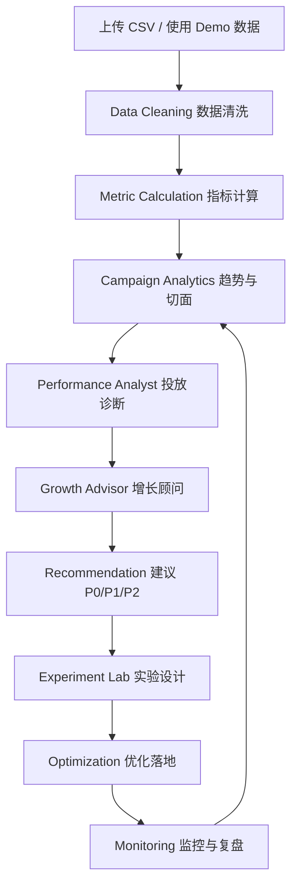

# MORI AI Growth OS — AI Growth Advisor PRD

> **文档性质**：轻量级 PRD（产品需求文档）｜**版本**：v1.0｜**范围**：AI Growth Advisor + Campaign Analytics + Experiment Lab 闭环  
> **数据说明**：MORI 是 **Demo / Portfolio 项目**，全文数据均为 **Demo / 模拟业务数据**，不是实际商业广告账户  
> **本文不含**任何真实客户、真实营收、真实产品使用量数据；涉及"目标/预期"的表述均为设计目标，不是既成结果

---

## 1. 产品背景

营销团队的数据、内容、投放与分析流程容易割裂：投放数据在广告后台、内容在文档、分析在 Excel、结论在聊天记录里。
结果是"**数据很多，但决策很慢**"，而且每做一次分析都要重复一遍取数与对口径。

MORI 希望把四件事串成一个闭环：

```text
Campaign Analytics（把数据算对）
      + AI Insight（解释发生了什么）
      + Growth Recommendation（给出该做什么）
      + Experiment（验证有没有用）
```

**AI Growth Advisor 就是这个闭环里的"决策层"**：它不重复计算指标，而是消费已经算好的指标与业务上下文，
输出可执行建议，并把建议设计成下一个可验证的实验。

### 为什么现在做

| 条件 | 现状 |
| --- | --- |
| 数据基础 | 已有统一指标口径（CTR / CPC / CVR / CPA / ROAS）与 30 天 Demo 投放数据 |
| 模型能力 | 主流模型已支持 **Structured Outputs（JSON Schema）**，可以稳定返回结构化结果 |
| 产品缺口 | 现有分析停留在"看板 + 人工判断"，缺少"结论 → 动作 → 验证"的连接 |

---

## 2. 目标用户

| 角色 | 典型诉求 | 在 MORI 里的使用路径 |
| --- | --- | --- |
| **品牌营销人员** | 本周该主推什么主题、预算往哪放 | Campaign Analytics → AI Growth Advisor → Content Studio |
| **增长运营人员** | 效率下降时先查哪一环、怎么验证 | Campaign Analytics → AI Growth Advisor → Experiment Lab |
| **广告投放人员** | 哪些素材加预算、哪些止损 | Campaign Analytics（素材级）+ Performance Analyst |
| **商业运营人员** | 用一句话讲清"发生了什么、为什么、下一步" | Growth Report（周报 + 归档） |

> 共同点：他们不需要更多图表，需要**在 5 分钟内得到可用结论**。

---

## 3. 核心痛点

| # | 痛点 | 具体表现 |
| --- | --- | --- |
| P1 | **数据分散** | 投放、内容、人群数据在不同系统，口径不一致 |
| P2 | **手工分析耗时** | 每周重复导出、清洗、算指标，真正用于判断的时间被压缩 |
| P3 | **AI 与业务数据割裂** | 通用 AI 不了解品牌、人群、竞品与账户历史，只能给通用建议 |
| P4 | **分析结果无法直接进入实验** | 报告写了"CVR 下降"，但没有下一步可执行的实验设计 |
| P5 | **建议缺乏验证闭环** | 建议是否正确、有没有效果，事后无法追溯 |
| P6 | **结论不可复核** | 数字与结论对不上，或者"模型说的"无法验证 |

---

## 4. 产品目标

### 用户目标

让用户完成一条完整动作链：

```text
导入 Campaign 数据 → 得到结构化指标 → 发现问题 → 获得 AI 分析
        → 得到增长建议 → 设计实验 → 验证结果
```

### 产品目标（可衡量）

| 层级 | 目标 | 衡量方式 |
| --- | --- | --- |
| 效率 | 把"取数 + 算指标 + 写诊断"从数小时压缩到一次交互 | 从上传 CSV 到拿到 AI 诊断的步骤数 |
| 质量 | 每一条结论都能追溯到具体指标 | 结论是否带 `evidence` 字段 |
| 可信度 | 指标与结论可被独立复核 | 原始 SQL 与产品指标一致 |
| 闭环 | 每条建议都能变成可验证实验 | 是否存在"实验设计"输出字段 |
| 稳定 | 模型异常不影响产品可用 | Fallback 成功率

> 说明：以上为**产品设计目标**。当前项目没有真实产品使用量数据，因此不提供"使用时长下降 X%"这类指标。

---

## 5. MVP 范围

MORI 主项目包含 14 个模块，但 **AI Growth Advisor 的 MVP 不需要覆盖全部**。

### MVP 核心闭环（本文范围）

| 模块 | 在 MVP 中的角色 |
| --- | --- |
| **Campaign Analytics** | 数据入口与指标层：CSV 上传 → 清洗 → 指标计算 → 趋势与三切面 |
| **AI Growth Advisor** | 决策层：把指标翻译成"诊断 + 假设 + 建议 + 实验" |
| **Experiment Lab** | 验证层：把建议变成 A/B 实验，用统计检验判断是否值得继续 |

### 明确不在 MVP 范围

| 不做 | 原因 |
| --- | --- |
| 真实广告平台 API 对接 | MVP 用 CSV 验证工作流，接入平台属 V2 |
| 自动调预算 / 自动上下线素材 | 涉及真实账户风险，MVP 只给建议、由人执行 |
| 登录、权限、多租户 | 作品集 Demo 阶段不需要（避免过度工程化） |
| 计费与套餐 | 同上 |

### MVP 成功标准（验证假设）

> **核心假设：如果给 AI 一套结构化业务上下文（指标 + 人群 + 内容 + 实验历史），
> 它能否产出"业务人员可以直接采取行动"的增长建议？**

| 验证维度 | 判定方式 |
| --- | --- |
| 结构化输出稳定 | 输出通过 Schema 校验的比例（本地测试覆盖 7 个 Agent 与非法输出场景） |
| 建议可执行 | 每条建议是否包含"做什么 / 对什么指标 / 如何验证" |
| 数字可复核 | 结论中引用的数字是否与数据库计算一致 |
| 失败不崩 | 模型超时 / 报错 / 返回非法 JSON 时是否自动回退并保持可用 |

---

## 6. 用户流程



### 关键交互节点

| 步骤 | 用户动作 | 系统响应 |
| --- | --- | --- |
| 1 | 上传投放 CSV（或直接用 Demo 数据） | 校验表头/日期/数字字段，输出数据质量问题清单 |
| 2 | 查看指标与趋势 | 展示 KPI、日趋势、渠道/素材/人群三切面 |
| 3 | 点击「AI Analyze Campaign」 | Performance Analyst 返回诊断 / 原因 / 假设 / 高效低效素材 / 预算建议 / 实验建议 |
| 4 | 在 AI Growth Advisor 提问 | 返回 Diagnosis → Main Reason → Hypothesis → Recommendation → Experiment |
| 5 | 进入 Experiment Lab 创建实验 | 输出 A/B 指标、z 值、p 值、结论方向与成功标准 |
| 6 | 生成 Growth Report | 输出 8 段式周报，可复制 / 导出 Markdown / PDF |

---

## 7. AI Agent 设计

### 为什么拆 Agent（而不是一个大 Prompt）

| 原因 | 说明 |
| --- | --- |
| 职责清晰 | 每个 Agent 只回答一类问题，Prompt 与输出契约可单独评估 |
| 输出稳定 | 每个 Agent 有独立 JSON Schema，字段更少、更聚焦 |
| 可版本管理 | Prompt 有版本号与变更记录（见 `/prompts`），可回归对比 |
| 失败可隔离 | 某个 Agent 失败可单独回退，不影响其它模块 |

### 本 PRD 重点：两个 Agent

#### 7.1 Performance Analyst（投放数据分析师）

| 项 | 内容 |
| --- | --- |
| 职责 | 回答"投放数据发生了什么、为什么、钱该怎么挪" |
| 输入 | 账户总指标、日趋势、渠道表现、素材排行、近 7 天 vs 前 7 天窗口对比、分人群表现、系统预计算信号 |
| 处理顺序 | ① 量级 → ② 流量效率（CTR/CPC）→ ③ 承接效率（CVR/CPA）→ ④ 结果效率（ROAS）→ ⑤ 结构集中度 |
| 输出（结构化） | `diagnosis`、`mainReason`、`hypotheses[]`、`winners[]`、`losers[]`、`budgetMoves[]`、`audiencesToTest[]`、`experiments[]`，以及 `insights / opportunities / risks / recommendations` 四组结论 |
| 关键约束 | 每条结论必须引用具体数值；必须说明如何排除其它解释；涉及实验必须标注为模拟数据推演 |
| Prompt 版本 | v1.5 |

#### 7.2 Growth Advisor（增长顾问）

| 项 | 内容 |
| --- | --- |
| 职责 | 回答业务问题，并把结论组织成"可执行 + 可验证"的路径 |
| 输入 | 品牌、产品、人群、竞品、投放、内容库、实验历史 + 用户提问 |
| 固定输出结构 | `diagnosis` → `mainReason` → `hypotheses[]`（含证据与置信度）→ `recommendation[]` → `experiment` → `dataUsed[]` |
| 特别要求 | 必须区分 **FACT（事实）/ HYPOTHESIS（假设）/ DATA GAP（缺什么数据）**；数据不足时必须说"数据不足"而不是编造 |
| 数据口径 | 全文必须写 Demo 口径（"Demo 数据显示""模拟实验结果""基于模拟数据推演"），禁止写成真实业绩或"已验证" |
| Prompt 版本 | v2.0 |

#### 7.3 其他 Agent（简要）

| Agent | 负责 | 输出要点 |
| --- | --- | --- |
| Market Analyst | 市场与竞品 | 竞争位置、市场空白、定位建议 |
| Audience Analyst | 用户洞察 | Persona 机会、四类机会卡片、广告角度 |
| Content Strategist | 内容策划 | 标题/正文/短视频脚本 + 内容评分 |
| Creative Strategist | 广告素材 | 5 个结构性差异方向 + 测试优先级 |
| Report Writer | 增长报告 | 8 段式周报（含下周实验） |

---

## 8. Structured Output

### 设计原则

> **AI 不返回自由文本，而是按预定义 JSON Schema 返回结构化对象。**

| 目的 | 说明 |
| --- | --- |
| 稳定解析 | 字段固定，前端无需解析自然语言 |
| 前端展示 | 每个字段对应确定的 UI 组件（卡片、表格、评分条） |
| 数据复用 | 结构化结果可落库、可对比、可进入下一步工作流 |
| 降低格式错误 | 通过 Schema 约束 + 本地校验（Zod）双重保障 |
| 便于后续流程 | 例如 `experiments[]` 可直接作为 Experiment Lab 的输入 |

### 实现要点

| 层 | 做法 |
| --- | --- |
| 契约 | 每个 Agent 用 zod 定义 Schema，并由同一份定义生成模型侧 JSON Schema（避免两处定义漂移） |
| 首选请求形状 | `response_format: { type: "json_schema", strict: true }`（官方 Structured Outputs） |
| 兼容降级 | 若上游不支持 strict（如 DeepSeek），按阶梯降级：`json_object` → 纯 JSON，并把 Schema 与"必填字段清单"注入 prompt |
| 校验 | 模型返回后统一由 zod 校验：字段缺失 / `null` / 类型错误都会被识别 |
| 修复式重试 | 校验失败时把"缺失字段与类型错误清单"回灌给模型重问（同形状最多 2 次），而不是直接丢弃可解析的回答 |
| 不静默修改 | 不会为了通过校验而放宽 `required`，也不会自动填充业务字段 |

### 示例（Campaign 分析输出，节选）

```json
{
  "diagnosis": "Demo 数据显示近 7 天 ROAS 从 3.23 降到 2.73（-15.38%），CTR 基本持平。",
  "mainReason": "主导环节是承接与转化效率：CVR 从 3.96% 降到 3.06%（-22.61%）。",
  "hypotheses": [
    { "hypothesis": "落地页承接与素材承诺不一致", "evidence": "CTR 持平但 CVR 下滑", "confidence": 78 }
  ],
  "budgetMoves": [
    { "from": "成分党深度解析", "to": "熬夜党晚间修护", "amount": "该素材约 50% 预算", "rationale": "ROAS 2.13 vs 4.26" }
  ],
  "experiments": [
    { "name": "价格解释型落地页 vs 原落地页", "variantA": "原落地页", "variantB": "价格解释 + 信任证据", "metric": "CVR", "hypothesis": "补齐购买理由后 CVR 回升" }
  ]
}
```

---

## 9. Fallback / Error Handling

### 风险来源

AI API 可能出现的异常：

| 异常 | 典型场景 |
| --- | --- |
| `TIMEOUT` | 长上下文 + 长输出超过客户端超时（默认 120s，可配置） |
| `HTTP_ERROR` | 上游 4xx/5xx（Key 失效、额度不足、模型名不存在、网关故障） |
| `INVALID_JSON` | 返回内容不是合法 JSON，或字段不符合 Schema |
| `EMPTY_RESPONSE` / `TRUNCATED` | 返回空内容，或被 token 上限截断 |
| `MISSING_API_KEY` | 未配置 Key（或 Demo 模式） |
| `NETWORK_ERROR` | 网络/代理不可达、连接被中断 |

### 处理策略（保证产品不会因为模型异常直接崩溃）

| 层级 | 策略 |
| --- | --- |
| 请求层 | 三级请求形状阶梯（`json_schema` → `json_object` → 纯 JSON）+ 修复式重试 + 截断时"更精简"重试 |
| 校验层 | zod 强校验；非法结构不进入 UI |
| 回退层 | 任何不可恢复的异常 → **自动回退到本地结构化分析引擎（Demo 引擎）**，结果照样渲染 |
| 透明层 | 结果卡片明确标注当前状态：`AI 生成` / `Demo 引擎` / `AI 失败 · 已回退`，并写明原因 |
| 安全层 | API Key 只在服务端读取；前端产物不含 Key；错误文案统一脱敏（`sk-***`） |

### 用户可见的三种状态

| 状态 | 触发条件 | 用户看到 |
| --- | --- | --- |
| **AI Mode** | `DEMO_MODE=false` 且配置 Key，调用成功 | `AI 生成` + 模型名 + 耗时 |
| **Demo Mode** | `DEMO_MODE=true`（默认）或未配置 Key | `Demo 引擎` + 说明"使用本地结构化分析引擎" |
| **Fallback** | 调用失败/超时/非法结构 | `AI 失败 · 已回退` + 具体错误原因 |

> 设计原则：**宁可显示"回退了"，也不显示空白页或错误堆栈。**

---

## 10. 核心指标

### 业务指标（由统一口径计算，AI 不参与计算）

| 指标 | 定义 | 用途 |
| --- | --- | --- |
| CTR | clicks / impressions | 素材吸引力 |
| CPC | spend / clicks | 流量成本 |
| CVR | conversions / clicks | 承接效率（本 PRD 的核心观测点） |
| CPA | spend / conversions | 获客成本 |
| ROAS | revenue / spend | 投放效率 |

### AI / 产品指标（设计目标与可观测项）

| 指标 | 定义 | 当前状态 |
| --- | --- | --- |
| AI analysis success rate | 成功返回并通过 Schema 校验的比例 | 本地上线前测试覆盖 7 个 Agent + 非法输出场景（无真实线上使用量数据） |
| Structured Output success rate | 输出通过 Schema 校验的比例 | 同上；测试断言"非法输出会被拒绝而不是渲染" |
| Fallback rate | 触发回退的比例 | 可通过 `meta.mode` 统计；Demo Mode 下全部为本地引擎 |
| Experiment completion | 实验是否走完"设计 → 执行 → 结论" | Experiment Lab 已支持创建、统计检验与结论输出（模拟数据） |
| 分析耗时 | 从触发到结果渲染的时间 | 本地实测：本地引擎 < 1s；真实模型 20–45s（视 provider 与上下文长度） |

> ⚠️ **当前项目没有真实产品使用量数据**（没有真实用户、没有埋点统计），因此不提供"成功率 95%""用户满意度 4.8"这类数字。
> 上表中凡是标注"设计目标/测试覆盖"的，都以本地验收结果为准，不代表线上真实使用数据。

---

## 11. 产品边界

| 边界 | 说明 |
| --- | --- |
| 产品性质 | MORI 当前是 **Demo / Portfolio 项目**，用于验证 AI 在营销分析与增长决策中的应用工作流 |
| 数据性质 | **全部为模拟业务数据**（虚拟品牌 + 生成式 Demo 数据集），不是实际商业广告账户 |
| 平台性质 | 不是生产级广告投放平台：不接真实广告平台 API、不自动调预算、不自动上下线素材 |
| 实验结果 | Experiment Lab 的结果为**模拟数据推演**，不代表真实线上 A/B 结果，需要真实流量复现 |
| AI 建议 | 必须人工审核后执行；AI 输出定位是"加速判断"，不是"替代决策" |
| 工程质量 | 已通过 `next build`、TypeScript 0 error、ESLint 0 problem、101 个自动化测试；SQLite 用于 Demo，不适合多用户生产环境 |
| 合规 | 不编造商业成绩（无 ROI 提升、无销售额提升）、不使用医疗/绝对化功效表述 |

---

## 12. 后续迭代

### V1（已完成 / 当前版本）

```text
Campaign Analytics  +  AI Growth Advisor  +  Experiment Lab
（CSV 上传 → 指标计算 → AI 诊断 → 建议 → 模拟实验）
```

### V2（规划中，尚未实现）

| 方向 | 内容 | 依赖 |
| --- | --- | --- |
| 真实数据接入 | 对接真实广告平台（Meta / 巨量 / 腾讯广告）与电商订单 | 平台授权、数据合规 |
| 更丰富的人群与素材分析 | 素材级 CVR、点击→加购中间指标、人群结构时间序列 | 埋点字段补齐（`audience` / `placement` / `conversion_event`） |
| 更强的实验管理 | 实验排期、样本量与显著性自动监控、实验结论自动回写 | 真实流量与实验周期 |
| 更多 AI Agent | 预算优化 Agent、素材疲劳预警 Agent、落地页一致性检查 Agent | 数据与评估集 |
| 评估与回归 | 建立 golden set 与 LLM-as-judge 评估，跟踪 Prompt 版本效果 | 人工标注评估集 |

> 以上均为**规划**，不声称已完成；当前版本以项目中实际存在的功能为准。

---

## 附录：与当前项目实现的对应关系

| PRD 章节 | 对应实现位置 |
| --- | --- |
| 指标口径 | `src/lib/metrics.ts`（唯一定义 + 除 0 保护） |
| Campaign Analytics | `/campaign` 页面 + `/api/campaign/analyze`、`/api/campaign/upload` |
| Performance Analyst | Agent `performance_analyst`（Prompt v1.5，`CampaignAnalysisSchema`） |
| Growth Advisor | `/advisor` 页面 + Agent `growth_advisor`（Prompt v2.0，`GrowthAdviceSchema`） |
| Structured Output | `src/lib/ai/json-schema.ts` + `src/lib/ai/schemas.ts`（zod ↔ JSON Schema 单一来源） |
| Fallback / 错误分类 | `src/lib/ai/client.ts`（三级阶梯、修复式重试、错误码）+ `src/lib/ai/runner.ts`（回退） |
| Experiment Lab | `/experiments` 页面 + `src/lib/experiments.ts`（双比例 z 检验、最小样本量） |
| Prompt 与版本管理 | `/prompts` 页面 + `src/lib/prompts.ts`（7 个 Agent） |
| 测试覆盖 | `tests/`（101 个用例，含结构化输出与可靠性用例） |

> 文档一致性声明：本文档描述的能力均已在当前 MORI 项目中实现；描述的实验与数据均为 **Demo / 模拟业务数据**。
